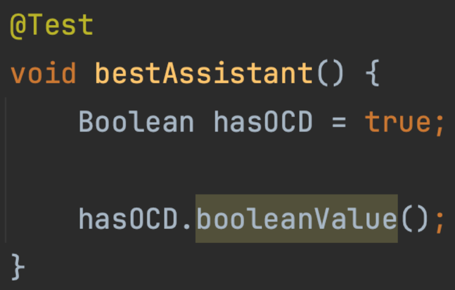
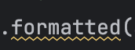
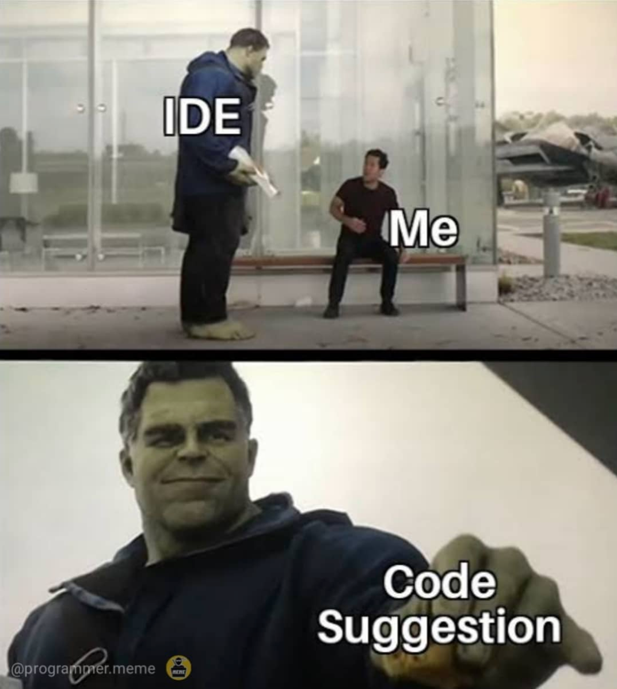

# Streams in Java

## After this lesson you can...

- Check that your tools (Java, Gradle, IntelliJ with Learn and Teach) are ready to run the course.
- Apply the IDE code suggestions that the course relies on.
- Find your way through the agenda: what a stream is, how to create one, intermediate and terminal operations, pitfalls and exercises.

## What to do

1. Open `src/Main.java` and run it. It prints the presenter's introduction.
2. Read the sections below: the agenda, the tools, how the course works and the cheat sheet.
3. Check that Java, the Gradle wrapper (`./gradlew`) and the Learn and Teach plugin work on your machine.

## What you should see

`Main` prints the block between `=== Introduction ===` and `=== End ===`. In `getOpenSourceProjects` the `for` loop
and the commented-out stream version do the same: you will write the second form in this course.

## Agenda

- Who am I?
- Introduction: the tools, the IDE suggestions and the domain
- Streams explained (+ debugging streams)
  - What is a Stream
  - Stream Initialization
  - Stream Intermediate operations
  - Stream Terminal operations
- Pitfalls
- Exercises: practice makes perfect

## Tools

- Terminal: [iTerm2](https://dev.to/abdfnx/oh-my-zsh-powerlevel10k-cool-terminal-1no0) on macOS, or [Windows Terminal](https://learn.microsoft.com/windows/terminal/) on Windows, or any terminal on Linux
- [sdkman](https://sdkman.io/) (optional, handy to install and switch Java versions)
- [Java 25 (LTS)](https://adoptium.net/temurin/releases/) via sdkman or any distribution
- [Gradle](https://gradle.org/): use the Gradle wrapper in the repo (`./gradlew`, `gradlew.bat` on Windows), nothing to install
- [IntelliJ IDEA](https://www.jetbrains.com/idea/)
- [Learn and Teach](https://www.jetbrains.com/help/idea/product-educational-tools.html)
- [JUnit](https://junit.org/) and [AssertJ](https://assertj.github.io/doc/) (already configured in the project)

## How this course works

- **Theory lessons**: open `src/Main.java`, read it top to bottom and run it.
- **Output tasks**: finish the TODO; your program's output must match the expected output.
- **Exercises**: implement the method; the unit tests tell you when you are done.
- **Pitfalls**: this code is broken *on purpose*. Run it and watch what goes wrong.
- Watch for IntelliJ suggestions (yellow/grey highlights). Applying them is part of the lesson.

## Before you start

You should be comfortable with:

- Java syntax, collections (`List`, `Set`, `Map`) and `for`-loops
- Records (all domain classes are records)
- Lambdas and method references (`x -> x * 2`, `String::length`). The cheat sheet below is a reminder.

## Cheat sheet: functional interfaces

A functional interface has exactly one abstract method, so a lambda or a method reference can implement it.

| Interface | Method | Meaning | Example |
|---|---|---|---|
| `Predicate<T>` | `boolean test(T t)` | answers yes or no about a value | `Predicate<String> isEmpty = s -> s.isEmpty();` |
| `Function<T,R>` | `R apply(T t)` | turns a value into another value | `Function<String,Integer> length = String::length;` |
| `Consumer<T>` | `void accept(T t)` | does something with a value, returns nothing | `Consumer<String> print = System.out::println;` |
| `Supplier<T>` | `T get()` | produces a value from nothing | `Supplier<List<String>> newList = ArrayList::new;` |
| `BinaryOperator<T>` | `T apply(T a, T b)` | combines two values of the same type | `BinaryOperator<Integer> add = (a, b) -> a + b;` |
| `Comparator<T>` | `int compare(T a, T b)` | orders two values (negative, zero or positive) | `Comparator<String> byLength = Comparator.comparingInt(String::length);` |

Calling them is plain Java:

    boolean empty = isEmpty.test("");          // true
    int size = length.apply("streams");        // 7
    print.accept("hello");                     // prints hello
    int sum = add.apply(2, 3);                 // 5
    List<String> words = new ArrayList<>(List.of("kiwi", "fig", "banana"));
    words.sort(byLength);                      // [fig, kiwi, banana]

## IDE Code suggestions

Some code is written so that IntelliJ will suggest an improvement (some snippets are intentionally suboptimal). Apply it with Alt+Enter, then compare before and after.

**When you see** 

**or** 

**you _must_ realize**

## Key takeaways

- Theory lessons: read and run `Main`. Output tasks: match the expected output. Exercises: make the tests green.
- Code suggestions from IntelliJ are part of the lesson: apply them with Alt+Enter and compare.
