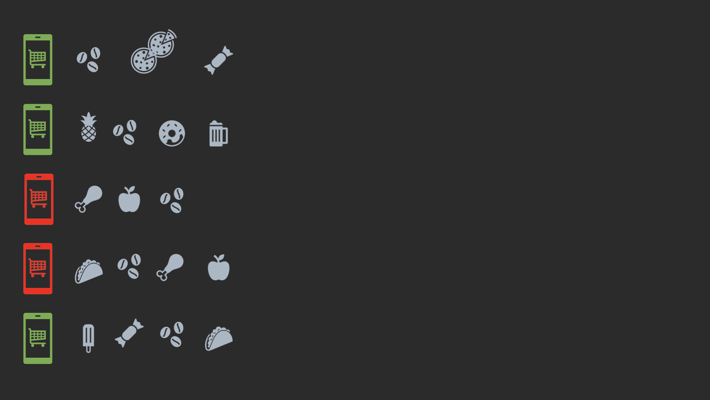

# Introduction to the domain

## After this lesson you can...

- Name the domain objects (`Article`, `Customer`, `Order`, `OrderLine`) and their fields.
- Explain how an order refers to articles through its order lines.
- Recognise this data in the demos and exercises that follow.

## What to do

1. Open the records in `src/domain` (`articles/Article.java`, `customer/Customer.java`, `orders/Order.java`,
   `orders/OrderLine.java`) and compare them with the table below.
2. Read the sections below. There is nothing to implement or check in this lesson.

## The records

Every demo and exercise uses the same four Java records. The table links the business concept to the record and to the
accessor methods you call in a lambda or method reference (for example `order.paid()` or `Order::paid`).

| Concept | Record | Accessors |
|---|---|---|
| Article | `Article(int id, String name)` | `id()`, `name()` |
| Customer | `Customer(int id, String name, String lastName)` | `id()`, `name()`, `lastName()` |
| Order | `Order(int id, int customerId, boolean paid, List<OrderLine> orderLines)` | `id()`, `customerId()`, `paid()`, `orderLines()` |
| Order line | `OrderLine(int articleId, int quantity, double price)` | `articleId()`, `quantity()`, `price()`, `total()` |

- An order line represents a single sale of a particular article: which article (`articleId`), how many (`quantity`)
  and the unit price (`price`).
- An order line refers to an article by `articleId`, and an order refers to a customer by `customerId`. These are plain
  ids, not objects: to get from an id to the `Article` or `Customer` you have to look it up.
- `OrderLine.total()` is `price * quantity`. It is added to `OrderLine` in the lessons that follow (this lesson's copy
  only has the three fields), and many demos call it to sum up an order.

## The orders

Each row is one order. A green phone is a paid order, a red phone an unpaid order. The icons are the order lines
(the articles that were bought). The picture is an illustration: the paid/unpaid pattern and the number of lines per
order match the sample data, but a few icons differ from the data in `Database.java`.

## The sample data

- 10 articles: Coffee, Pizza, Candy, Pineapple, Donuts, Beer, Apple, Taco, Chicken, Ice Cream.
- 5 orders: 3 paid (orders 1, 2 and 5) and 2 unpaid (orders 3 and 4).
- Customers only appear in the exercises; the demo lessons only use articles and orders.
- The sample `Database` is almost identical in all lessons: same orders, prices and paid status. Lessons differ only in
  small extras (for example a ready-made `orderLines` list), and the two "My first Stream" tasks refer to some articles
  by a different id than the other lessons.
- In the Pitfalls lesson the `Database` lookups also contain a `Thread.sleep`, to simulate a slow call.

## What you should see

You can name the four records and their fields, and you can explain why you need a lookup to get from an `articleId` or a
`customerId` to the object it refers to.

## Key takeaways

- Four records: `Article`, `Customer`, `Order` and `OrderLine`. All accessors are plain methods such as `paid()`.
- References between records are plain ids, so you look the related object up.
- The sample data is the same in (almost) every lesson: 10 articles and 5 orders, 3 paid and 2 unpaid.
